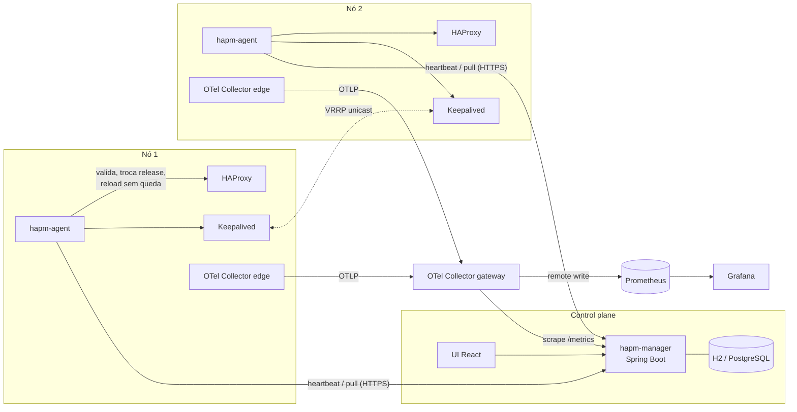

# HAPM — HAProxy HA Manager

Gerência de **HAProxy em alta disponibilidade** — algo como o *nginx-proxy-manager*, mas para HAProxy e com
foco em HA: setup dos nós, gestão de listeners, regras, backends e certificados (upload ou Let's Encrypt),
publicação versionada com rollout seguro e rollback, e monitoramento via **OpenTelemetry Collector → Prometheus → Grafana**.

| Ambiente | Topologia | Quem garante a HA da entrada |
|---|---|---|
| **On-premise** | HAProxy + **Keepalived** (VRRP unicast, VIP flutuante) | Keepalived move o VIP em ~3 s |
| **AWS (recomendado)** | **NLB** + Auto Scaling Group de HAProxy | NLB (multi-AZ, gerenciado pela AWS) |
| **AWS (alternativa)** | HAProxy + Keepalived movendo **Elastic IP / IP privado secundário** via API | Keepalived + script de failover |

Stack: **Java 21 + Maven**, Spring Boot 4.1 no manager, agente em Java puro (jar único, sem Spring),
UI em **React** compilada durante o build Maven e servida pelo próprio jar. Node/npm são usados **somente no build**
da UI (baixados pelo `frontend-maven-plugin`); nada de Node roda em produção.

---

## Arquitetura



**Modelo pull:** o agente só precisa de saída HTTP(S) até o manager (nada abre portas de entrada nos nós).
A cada poucos segundos ele envia um heartbeat (versão aplicada, estado VRRP, resultado da última aplicação) e
recebe a versão desejada.

### Como uma publicação acontece
1. Você edita listeners/backends/certificados na UI. Nada vai para os nós até clicar em **Publicar**.
2. O manager gera o `haproxy.cfg` (e um `keepalived.conf` por nó), mostra o **diff** e valida com `haproxy -c`.
3. A publicação cria uma **versão imutável** (snapshot completo → rollback exato).
4. **Rollout seguro:** nós **BACKUP primeiro (canário)**, o **MASTER por último**; em modo sequencial, um nó por vez.
5. Em cada nó o agente grava a release em `/etc/haproxy/hapm/releases/vN`, valida de novo com `haproxy -c`,
   troca o symlink `current` **atomicamente** e recarrega o HAProxy sem derrubar conexões
   (master-worker / `systemctl reload`). Se o reload ou o health-check falharem, **volta sozinho** para a release anterior.
6. Se qualquer nó falhar, a publicação é marcada como falha e **todos os nós voltam para a última versão boa**
   — o MASTER nunca chega a receber uma config que falhou no canário.

### O que dá para gerenciar
- **Listeners (frontends):** binds múltiplos (HTTP/TCP, TLS com SNI via crt-list, HTTP/2), redirect HTTP→HTTPS, HSTS,
  X-Forwarded-For/Proto, allowlist de IPs, rate limit por IP, timeouts, bloco avançado.
- **Regras** (avaliadas em ordem, condições com AND e negação): host (inclusive `*.dominio`), caminho
  (exato/prefixo/sufixo/regex), método, IP de origem, header, SNI (TCP) → encaminhar para backend, redirecionar,
  negar, definir/remover header.
- **Backends:** servidores (peso, backup, maxconn, desativar), balanceamento, health-check HTTP/TCP, sessão
  persistente por cookie, TLS até os servidores, compressão, resolução DNS em runtime.
- **Certificados:** upload de PEM (valida par chave/certificado, extrai domínios e validade) ou **ACME/Let's Encrypt
  HTTP-01** com renovação automática (30 dias antes) e publicação automática após renovar.
- **Nós:** auto-registro, prioridade VRRP (automática ou manual), estado MASTER/BACKUP, versão aplicada, erros.
- **Auditoria** de todas as ações; histórico de versões com diff e rollback.

Segurança da geração: todo valor que vira configuração é validado contra injeção (sem quebras de linha, aspas ou
`#`); o bloco "avançado" não pode abrir novas seções; nomes `hapm_*` são reservados.

---

## Estrutura do repositório

```
pom.xml                    POM pai (Maven multi-módulo)
hapm-core/                 modelo, validação, render de haproxy.cfg/keepalived.conf (Java puro)
hapm-ui/                   React + Vite + TypeScript (frontend-maven-plugin -> META-INF/resources)
hapm-manager/              Spring Boot: API REST, UI, publicação, ACME, /metrics  (+ Dockerfile)
hapm-agent/                agente Java (jar único) + scripts do keepalived + unit systemd
observability/             OTel Collector (edge e gateway), Prometheus (+ alertas), Grafana (dashboard)
deploy/ansible/            setup on-premise (manager, HAProxy, Keepalived, agente, OTel)
deploy/terraform/aws-nlb/  AWS: NLB + Auto Scaling Group
deploy/aws/                política IAM para o modo aws-eip
lab/                       ambiente completo em Docker (2 nós com VIP real, backends, observabilidade)
```

## Build

Requisitos: **JDK 21** e **Maven 3.9+** (o Node para a UI é baixado pelo próprio build).

```bash
mvn clean verify          # compila tudo e roda os testes
# artefatos:
#   hapm-manager/target/hapm-manager.jar   (inclui a UI)
#   hapm-agent/target/hapm-agent.jar
```

Rede corporativa sem acesso à internet: aponte `-Dnode.download.root=` e `-Dnpm.registry=` para o
Nexus/Artifactory (há proxies prontos para `nodejs.org/dist` e para o registry npm), além do mirror Maven.

Os testes usam `haproxy` e `keepalived` reais quando instalados (são pulados se não existirem), incluindo um
teste ponta a ponta com manager + agente + HAProxy em master-worker.

Desenvolvimento da UI com hot reload: `cd hapm-ui && npx vite` (faz proxy de `/api` para o manager em `:8080`).

## Lab completo em Docker

Sobe manager, 2 nós HAProxy+Keepalived compartilhando o VIP `172.30.0.100`, 3 backends, OTel Collector
(edge por nó + gateway), Prometheus e Grafana — e já publica a primeira versão.

```bash
./lab/setup.sh
curl http://172.30.0.100/            # round-robin entre app1 e app2
docker compose -f lab/docker-compose.yml stop lb1   # failover: o VIP vai para o lb2 em ~3 s
```

- Manager: http://localhost:8080 (admin / admin12345)
- Grafana: http://localhost:3000 (dashboard *HAPM · HAProxy alta disponibilidade*)
- Prometheus: http://localhost:9090

## On-premise (Ansible)

```bash
mvn -q -DskipTests package
cd deploy/ansible
# edite inventories/exemplo/hosts.yml e group_vars/all.yml (segredos via ansible-vault)
ansible-playbook site.yml --limit hapm_manager          # 1) sobe o manager
# 2) na UI: crie o cluster (VIPs, interface, router id), copie o token de join para vault_hapm_join_token
ansible-playbook site.yml --limit haproxy_nodes          # 3) nós: HAProxy, Keepalived, agente, OTel
```

O role do HAProxy aponta a unit systemd para `/etc/haproxy/hapm/current/haproxy.cfg`, habilita
`ip_nonlocal_bind` (bind no VIP mesmo em BACKUP) e o master CLI. Firewall entre os nós: liberar **VRRP (protocolo IP 112)**.
Os playbooks foram escritos para Debian/Ubuntu (RHEL: pacotes cobertos; a unit do HAProxy usa `/etc/sysconfig`, ajuste o drop-in).

Recomendações: 2 ou 3 nós em racks/hosts físicos diferentes; `virtual_router_id` único por segmento L2;
manager atrás de TLS (reverse proxy ou o próprio HAProxy).

## AWS

### Opção 1 (recomendada): NLB + Auto Scaling — `deploy/terraform/aws-nlb`
O NLB é a entrada multi-AZ; os nós HAProxy ficam num ASG e se registram sozinhos no manager (nome = instance-id).
Health-check do NLB em `:8405/healthz` (frontend interno `hapm_stats`), IP do cliente preservado, IMDSv2,
acesso por SSM Session Manager, `instance_refresh` rolling. O token de join fica no SSM Parameter Store
(SecureString) e os artefatos num bucket S3. Crie o cluster no manager com topologia **aws-nlb**.

```bash
cd deploy/terraform/aws-nlb
cp terraform.tfvars.example terraform.tfvars   # preencha
terraform init && terraform apply
```

> ⚠️ Este módulo **ainda não foi validado** com `terraform validate/plan` (não foi possível baixar o Terraform no
> ambiente em que foi escrito). Revise e rode `terraform validate` antes do primeiro uso.

### Opção 2: Keepalived + Elastic IP / IP privado (topologia **aws-eip**)
Para quando não se quer NLB (custo, IP fixo de saída, protocolos específicos). Keepalived em **unicast** (a AWS não
tem multicast); ao virar MASTER, o `keepalived-notify.sh` usa a API da AWS para mover o **EIP** e/ou o
**IP privado secundário** para a própria ENI. Requer:
- instance profile com `deploy/aws/eip-failover-iam-policy.json`;
- `aws` CLI nos nós; security group liberando protocolo 112 entre eles;
- IP privado secundário só funciona com os nós **na mesma subnet/AZ** (o EIP funciona entre AZs);
- failover típico de 5–15 s (a chamada à API da AWS domina o tempo).

## Observabilidade

```
HAProxy (exporter nativo :8405/metrics) ┐
hapm-agent (:9101/metrics)              ├─> OTel Collector edge (por nó) ─OTLP─> OTel gateway ─remote write─> Prometheus ─> Grafana
métricas do host (hostmetrics)          ┘                                         ↑ raspa o manager (/metrics)
```

- `observability/otel-collector/node.yaml` e `gateway.yaml`; labels `hapm_cluster` / `hapm_node` em tudo.
- `observability/prometheus/alerts.yml`: sem MASTER, **split-brain**, keepalived parado/FAULT, HAProxy fora,
  nó sem heartbeat, publicação falhou, config divergente, backend sem servidores, servidor DOWN, 5xx > 5%,
  certificado expirando/expirado.
- `observability/grafana/dashboards/hapm-overview.json`: MASTER atual, linha do tempo VRRP (failovers),
  versão por nó, req/s, respostas por classe, 5xx, sessões, negadas (allowlist/rate limit/deny), backends,
  servidores fora, expiração de certificados, CPU/memória dos nós. Gerado por `build-dashboard.mjs`
  (ferramenta de desenvolvimento; o JSON versionado é o que vai para o Grafana).

Métricas próprias: `hapm_vrrp_is_master`, `hapm_vrrp_state{state}`, `hapm_keepalived_running`, `hapm_haproxy_up`,
`hapm_config_applied_version`, `hapm_config_desired_version`, `hapm_config_apply_total{result}`,
`hapm_certificate_not_after_timestamp_seconds`, `hapm_node_online`, `hapm_cluster_deployment_failed`…

## Configuração

**Manager** (variáveis de ambiente): `HAPM_PORT` (8080), `HAPM_DATA_DIR`, `HAPM_ADMIN_USER`/`HAPM_ADMIN_PASSWORD`
(senha aleatória no log se vazio), `HAPM_SECRET` (assinatura das sessões; defina o mesmo em todos os managers),
`HAPM_DB_URL`/`HAPM_DB_USER`/`HAPM_DB_PASSWORD` (PostgreSQL), `HAPM_ACME_DIRECTORY`
(`acme://letsencrypt.org`; staging: `acme://letsencrypt.org/staging`), `HAPM_HAPROXY_BIN`, `HAPM_NODE_OFFLINE_AFTER` (15 s).

**Agente**: ver `hapm-agent/src/main/dist/systemd/agent.env.example` — `HAPM_MANAGER_URL`, `HAPM_JOIN_TOKEN`,
`HAPM_NODE_NAME`, `HAPM_NODE_INTERFACE`/`HAPM_NODE_ADDRESS`, `HAPM_RELOAD_MODE` (`systemd` | `master-socket` | `command`).
CA interna para o manager: importe no truststore do JVM ou use `-Djavax.net.ssl.trustStore=`.

**HA do próprio manager:** os nós continuam servindo tráfego se o manager cair (só não recebem mudanças). Para
redundância do control plane: 2+ instâncias atrás de um balanceador, mesmo `HAPM_SECRET`, banco PostgreSQL.

## API (resumo)

Autenticação: `POST /api/auth/login` → `Authorization: Bearer <token>`.

| Método | Caminho | |
|---|---|---|
| GET/POST | `/api/clusters` | listar / criar cluster |
| GET/PUT/DELETE | `/api/clusters/{id}` | detalhar (inclui token de join) / alterar / remover |
| GET/POST/PUT/DELETE | `/api/clusters/{id}/{frontends\|backends\|certificates}[/{oid}]` | CRUD |
| POST | `/api/clusters/{id}/certificates/{oid}/issue` | emitir/renovar ACME |
| GET | `/api/clusters/{id}/nodes` | nós, estado VRRP, versão desejada |
| GET | `/api/clusters/{id}/preview` | config gerada, diff, `haproxy -c` |
| POST | `/api/clusters/{id}/deployments` | publicar (`{"note": "..."}`) |
| POST | `/api/clusters/{id}/deployments/{did}/rollback` | nova versão com a config antiga |
| GET | `/api/audit` | auditoria |
| — | `/agent/v1/heartbeat`, `/agent/v1/bundle/{v}` | uso dos agentes (token de join) |
| GET | `/metrics`, `/actuator/health` | Prometheus / health |

## Limitações conhecidas e próximos passos
- Usuário único/admin; **OIDC/LDAP e papéis** (somente leitura, aprovador de publicação) são o próximo passo natural.
- Chaves privadas dos certificados ficam no banco do manager (proteja o volume/banco; criptografia em repouso com KMS/Vault está no roadmap).
- ACME apenas HTTP-01 (sem wildcard); DNS-01 (Route 53 etc.) no roadmap.
- Logs de acesso do HAProxy → OTel (receiver syslog) → Loki ainda não incluídos.
- Scale-in na AWS deixa o nó como "offline" no manager até ser removido (lifecycle hook para remoção automática no roadmap).
- Templates de erro customizados, `userlist`/basic auth, cache e peers (stick-table sincronizada entre nós) ainda não expostos na UI (use o bloco avançado).
