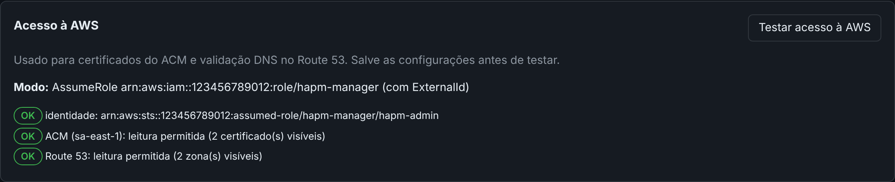
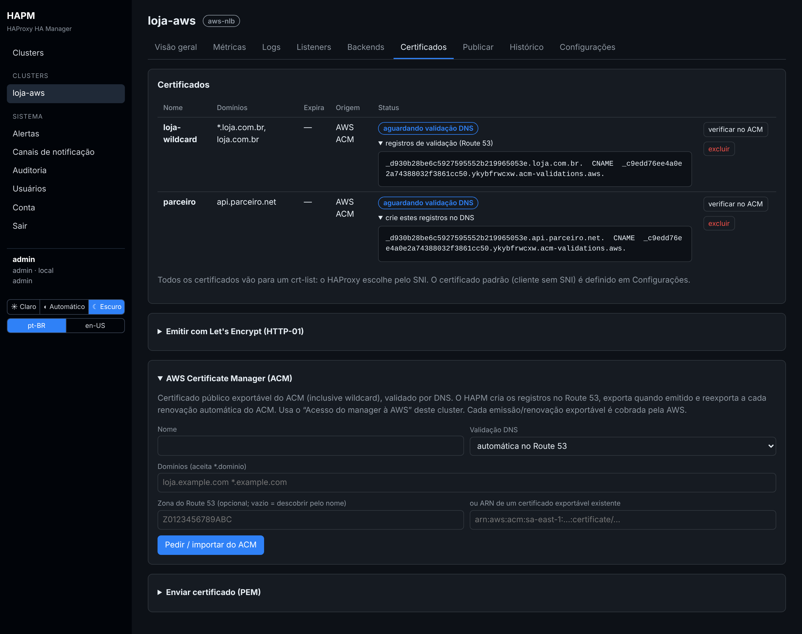

# AWS: credenciais do manager e certificados do ACM

## Como o manager acessa a AWS

Configurações do cluster › **Acesso do manager à AWS** (ADMIN):

| Campo | Efeito |
|---|---|
| Região | região do ACM (o Route 53 é global). Vazio = a região do failover, ou `us-east-1` |
| Role a assumir | vazio = **cadeia padrão do SDK**; preenchido = `sts:AssumeRole` nessa role |
| ExternalId | exigido pela trust policy da role (recomendado quando a role está em outra conta) |
| Duração da sessão | 15 a 720 min (padrão 60); as credenciais são renovadas sozinhas antes de vencer |

**Sem role** o manager usa a cadeia padrão do AWS SDK, na ordem: variáveis de ambiente, perfil/SSO
(`~/.aws`), **role da tarefa ECS**, **IRSA** (EKS) e **instance profile** da EC2. É o recomendado: nenhuma chave fica
no HAPM, e o manager herda a role da máquina onde roda. Chave de acesso fixa (`AWS_ACCESS_KEY_ID`/
`AWS_SECRET_ACCESS_KEY` no `manager.env`) funciona, mas evite.

**Com role** o manager assume a role com credenciais temporárias:

- **sessão** `hapm-<usuário>` nas ações da tela (pedir certificado, testar acesso) e `hapm-<cluster>` nas rotinas
  (renovação, validação) — no **CloudTrail** aparece quem fez o quê;
- um manager central pode operar **várias contas** (produção, homologação), uma role por cluster, sem chaves;
- a role precisa confiar na identidade do manager — exemplo em `deploy/aws/hapm-manager-trust-policy.json`
  (exige o ExternalId e sessões `hapm-*`).

O botão **Testar acesso à AWS** mostra a identidade obtida (`sts:GetCallerIdentity`) e se a leitura no ACM e no
Route 53 é permitida — sem alterar nada.

**Política mínima** da role/identidade do manager: `deploy/aws/hapm-manager-iam-policy.json` (ACM: pedir, descrever,
exportar e listar; Route 53: listar zonas e criar/atualizar **só registros CNAME `_*` de validação**).

### Role no failover dos nós (topologia aws-eip)

Os nós movem IPs com o **instance profile** da EC2. Se a rede estiver em outra conta (ou você quiser separar
permissões), preencha em *AWS: failover de IP entre ENIs* a **Role a assumir no failover** (+ ExternalId): o
`keepalived-notify.sh` faz `sts:AssumeRole` (sessão `hapm-failover-<host>`) antes das chamadas EC2, e o preflight
acusa trust policy errada. O instance profile precisa de `sts:AssumeRole` nessa role.

## Certificados do ACM

Desde junho de 2025 o ACM emite **certificados públicos exportáveis**: a chave privada pode sair da AWS e ser usada
no HAProxy. Aba **Certificados › AWS Certificate Manager (ACM)**:

1. **Domínios** (até 10, aceita `*.dominio` — wildcard, que o Let's Encrypt via HTTP-01 não cobre) e **validação**:
   - *automática no Route 53*: o HAPM cria os CNAMEs de validação na zona pública que contém cada nome (ou na zona
     informada);
   - *manual*: a tela mostra os registros para você criar no seu DNS.
2. O HAPM pede o certificado com `Export=ENABLED` (com tags `hapm-cluster`/`hapm-certificate`) e acompanha a
   validação a cada minuto.
3. Emitido, o HAPM **exporta** (`ExportCertificate` com uma passphrase aleatória de uso único), decifra a chave
   (PKCS#8) no manager, guarda como qualquer certificado e **publica** (se "publicar automaticamente quando um
   certificado for renovado" estiver ligado no cluster).
4. **Renovação**: o ACM renova sozinho; a cada 6 h o HAPM compara a validade e, se mudou, exporta de novo, publica e
   avisa (alerta informativo `acm-renewed`).

Também dá para usar um **certificado exportável já existente** informando o ARN. Certificados pedidos antes de
17/06/2025 ou sem `Export=ENABLED` **não** são exportáveis: o HAPM mostra o erro e alerta (`acm-failed`).

> **Custo:** a AWS cobra cada emissão e cada renovação de certificado exportável (no lançamento: cerca de US$ 15 por
> nome e US$ 149 por wildcard; validade de 395 dias). A tela pede confirmação antes do pedido.

Alternativa sem exportar a chave: na topologia **aws-nlb**, termine o TLS no próprio NLB com um certificado ACM comum
(listener TLS do NLB) e use listeners TCP/HTTP no HAProxy. A chave nunca sai da AWS, mas as regras por SNI/host em
TLS ficam com o NLB.

## Validação

Sem conta AWS no ambiente de desenvolvimento, os testes usam uma **AWS simulada** que fala os protocolos reais do
SDK (STS query/XML, ACM JSON 1.1, Route 53 REST/XML) — `hapm-manager/src/test/java/dev/hapm/manager/FakeAws.java`:
cadeia padrão, AssumeRole com ExternalId e nome de sessão, trust policy negada, permissão faltando, pedido
exportável, CNAME no Route 53, emissão só depois da validação, exportação com chave cifrada, renovação, ARN
existente e ARN não exportável. Também foi exercitado contra o **moto** (outra implementação dos protocolos da AWS): AssumeRole com ExternalId,
pedido exportável no ACM e CNAME criado na zona certa do Route 53. Contra uma conta real **ainda não foi validado**.
