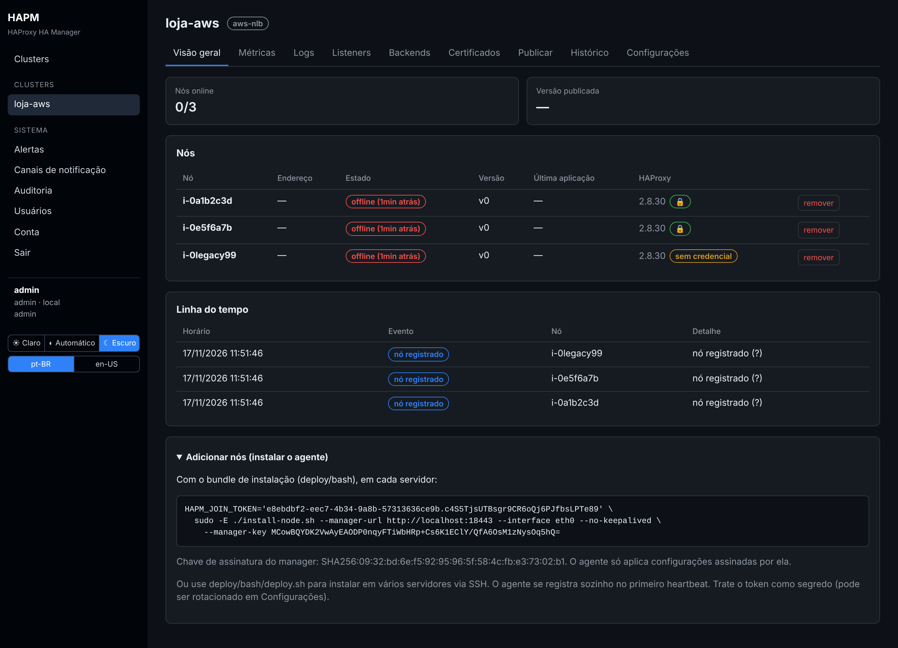

# Control plane x data plane

| | Control plane (manager) | Data plane (cada nó) |
|---|---|---|
| Componentes | interface, API, banco, validação, geração das configurações, aprovações, alertas, busca de logs, ACM | HAProxy, Keepalived, hapm-agent, OTel Collector |
| Fica fora do ar | sem publicar, sem registrar nós novos, sem alertas | o outro nó assume o VIP (failover) |
| Tráfego dos clientes | nunca passa pelo manager | sempre |

## O que garante a separação

- **Só o nó inicia conexões** (modelo pull): o agente consulta o manager a cada 5 s por HTTP(S) de saída. O manager
  não acessa os nós — sem SSH, sem porta aberta nos nós para ele.
- **O nó funciona sozinho**: com o manager fora do ar, o HAProxy segue com a última versão aplicada (inclusive
  drenar/manutenção já aplicados), o failover acontece entre os nós e métricas/logs seguem pelo OTel.
- **O nó valida o que recebe**: confere o hash e a **assinatura** do bundle, roda `haproxy -c` e `keepalived -t`
  localmente e volta sozinho à versão anterior se o reload ou o health-check falhar.

## Reforços

### Porta exclusiva dos agentes

`install-manager.sh --agent-port 8443` (ou `HAPM_AGENT_PORT`): o manager abre uma segunda porta que atende **só**
`/agent/**`, o desafio ACME (`/.well-known/acme-challenge/`) e `/actuator/health`. A porta da interface deixa de
atender os agentes (404), e a porta dos agentes não serve a interface nem a API (404). No firewall: rede dos nós →
porta dos agentes; rede de administração → porta da interface. A tela "Adicionar nós" já mostra o comando com a porta
certa.

### Credencial própria por nó

O **token de join** é do cluster e serve para **registrar**. No primeiro heartbeat o agente pede uma credencial e o
manager entrega uma **credencial própria do nó** (32 bytes aleatórios), **uma única vez**; o manager guarda só o
hash (SHA-256). A partir daí, heartbeats e downloads daquele nó exigem a credencial (cabeçalho `X-HAPM-Node-Token`):
quem só tem o token de join **não se passa** por um nó existente.

- O agente guarda em `/var/lib/hapm/node.token` (0600).
- Agente que perdeu o estado (disco refeito): remova o nó na tela; ele se registra de novo e recebe outra credencial.
- **Configurações › Nós › Aceitar registro de nós novos**: desligue depois de registrar os nós — o token de join
  deixa de valer até para nomes novos (útil se ele vazar). Na AWS com Auto Scaling, mantenha ligado.
- Agentes antigos (sem suporte) continuam funcionando só com o join e aparecem como "sem credencial" na lista de nós.

### Bundles assinados (Ed25519)

O manager tem um par de chaves Ed25519 (gerado no primeiro uso, guardado no banco — com vários managers, todos usam o
mesmo). Cada bundle é assinado sobre `cluster + versão + hash canônico do conteúdo`, e o agente **só aplica** bundles
com assinatura válida pela chave **fixada no nó**:

- `install-node.sh --manager-key <chave>` fixa a chave já na instalação (recomendado; o comando da tela já inclui);
- sem isso, a chave é fixada no **primeiro contato** (o log do agente mostra a impressão digital para conferir com a
  tela) e guardada em `/var/lib/hapm/manager-signing.pub`;
- se o manager passar a anunciar outra chave, o agente **para de aplicar versões novas** e registra o erro.

Assim, nem quem se colocar entre o nó e o manager, nem quem tiver só o token de join, consegue fazer um nó aplicar
uma configuração que o manager não gerou.

API: `GET /api/system/signing-key` (chave, impressão digital e porta dos agentes).

## Ainda não coberto

- **TLS/mTLS** entre agente e manager: use um proxy com TLS (o próprio HAProxy) na frente das duas portas; mTLS com
  certificado por nó está no roadmap.
- Rotação da chave de assinatura: hoje é manual (gerar novo par no banco e redistribuir `--manager-key`).
- A chave de assinatura e as chaves privadas dos certificados ficam no banco do manager (proteja-o; criptografia com
  KMS/Vault está no roadmap).
- Emissão Let's Encrypt (HTTP-01) depende de o HAProxy alcançar o manager durante a validação; com ACM (DNS) não.
