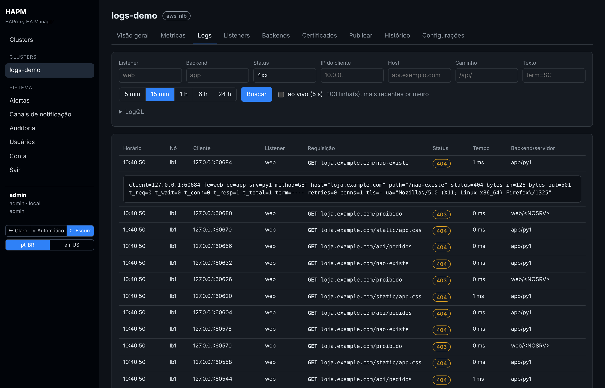

# Logs de acesso: Loki, SIEM e busca na tela

Cada requisição HTTP (e cada conexão TCP) gera uma linha **logfmt** — chave=valor, legível e interpretável sem regex:

```
client=10.1.2.3:51234 fe=https be=web srv=web1 method=GET host="loja.example.com" path="/api/pedidos" status=200
bytes_in=412 bytes_out=5120 t_req=0 t_wait=0 t_conn=1 t_resp=12 t_total=13 term=---- retries=0 conns=37 tls=TLSv1.3
ua="Mozilla/5.0 ..."
```

TCP: `client fe be srv bytes_in bytes_out t_wait t_conn t_total term retries conns`. Aspas e barras no Host/User-Agent
são escapadas (`\"`, `\\`), então nenhum valor quebra o formato.

| Campo | Significado |
|---|---|
| `t_req` / `t_wait` / `t_conn` / `t_resp` / `t_total` | ms para receber a requisição / na fila / para conectar no servidor / até a resposta / total |
| `term` | estado de término do HAProxy (`----` = normal; `SC--` = servidor recusou; `PR--` = negado por regra; `cD--` = timeout do cliente...) |
| `srv=<NOSRV>` | não chegou a um servidor (regra deny, redirect, backend sem servidores) |

## Caminho

```
HAProxy (cada nó) --syslog RFC 5424/UDP--> OTel Collector do nó (127.0.0.1:5514)
      |                                          | OTLP (+ hapm.cluster, hapm.node, service.name=hapm-haproxy)
      |                                          v
      |                                   OTel Collector gateway --OTLP--> Loki 3 (/otlp)  --> tela "Logs" e Grafana
      |                                                          \--------> SIEM (syslog/TCP+TLS, Splunk HEC, OTLP)
      \--syslog RFC 5424/UDP direto--> SIEM (opcional, sem OTel)
```

## Habilitar

1. **Configurações do cluster › Logs de acesso**: marque *Enviar logs de acesso* e publique. Opcional: *Destinos syslog
   adicionais (SIEM)* — até 4 `host:porta` (UDP) que recebem cópia direto do HAProxy; *Incluir User-Agent*.
2. Nos nós, o OTel Collector instalado com `install-node.sh --otel-gateway ...` já escuta em `127.0.0.1:5514`
   (`observability/otel-collector/node.yaml`).
3. No gateway, defina `LOKI_OTLP_ENDPOINT` (ex.: `http://loki:3100/otlp`; Loki 3.x com schema v13 aceita OTLP nativo).
4. No manager, `HAPM_LOKI_URL=http://loki:3100` liga a aba **Logs** (opcional: `HAPM_LOKI_TENANT` para `X-Scope-OrgID`
   em Loki multi-tenant, `HAPM_LOKI_TOKEN` para Bearer).

O lab Docker (`lab/`) já sobe Loki, liga os logs e configura o Grafana com o datasource Loki.

## SIEM

Duas formas, combináveis:

- **Direto do HAProxy** (mais simples): destinos syslog em *Configurações › Logs de acesso*. UDP, RFC 5424, com o
  hostname do nó. Bom para QRadar, ArcSight, Wazuh, Graylog, Splunk (input syslog), Sentinel via AMA.
- **Pelo gateway OTel** (com fila, retry e TLS): some `observability/otel-collector/gateway-siem.yaml`:
  ```
  otelcol-contrib --config gateway.yaml --config gateway-siem.yaml
  ```
  Traz exportadores prontos: `syslog/siem` (TCP+TLS, RFC 5424), `splunk_hec/siem` (Splunk HTTP Event Collector) e
  `otlphttp/siem` (Elastic, Datadog, Grafana Cloud...). Escolha na lista `exporters` do pipeline de logs.

## Buscar na tela

Aba **Logs** do cluster (OPERATOR ou acima — os logs têm IPs de clientes): filtros por listener, backend, status
(`5xx`, `4xx` ou um código), IP do cliente, host, caminho e texto livre; janela de 5 min a 24 h; modo "ao vivo"
(a cada 5 s); clique numa linha para ver o log cru. A consulta LogQL gerada aparece em "LogQL" para copiar ao Grafana.
Os filtros aceitam só letras, números e `. : / - _` (sem aspas/espaços), para não ser possível alterar a consulta.

API: `GET /api/clusters/{id}/logs?minutes=15&status=5xx&frontend=web&client=10.0.&path=/api&limit=200`.

No Grafana (Explore › Loki):

```
{service_name="hapm-haproxy"} | hapm_cluster="loja-prod" | logfmt | status >= 500
sum by (fe) (rate({service_name="hapm-haproxy"} | logfmt | status=~"5.." [5m]))
quantile_over_time(0.95, {service_name="hapm-haproxy"} | logfmt | unwrap t_total [5m]) by (be)
```



## Validação

O caminho completo foi testado com HAProxy 2.8 real, `otel/opentelemetry-collector-contrib:0.114.0` (nó e gateway) e
`grafana/loki:3.3.2`: as linhas chegam ao Loki com `hapm_cluster`/`hapm_node`, e os filtros da tela (status, listener,
caminho, cliente, host, nó) retornam o esperado. As três configurações do collector passam em `otelcol validate`.
