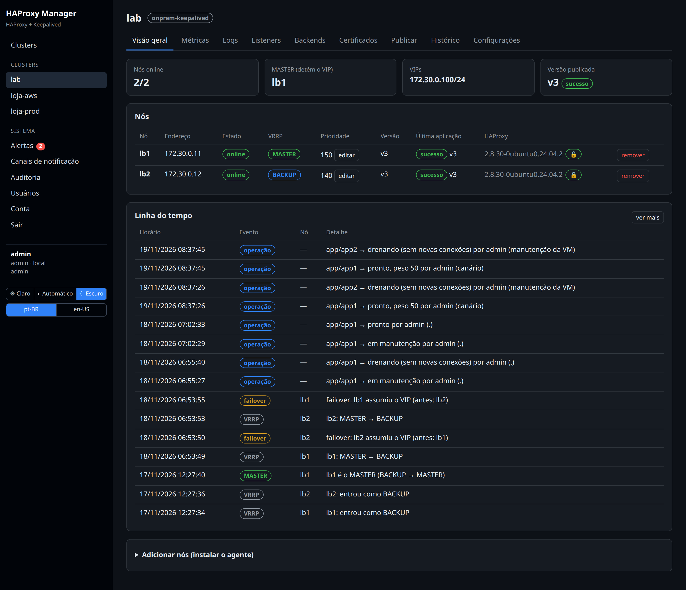
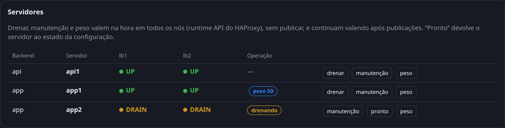
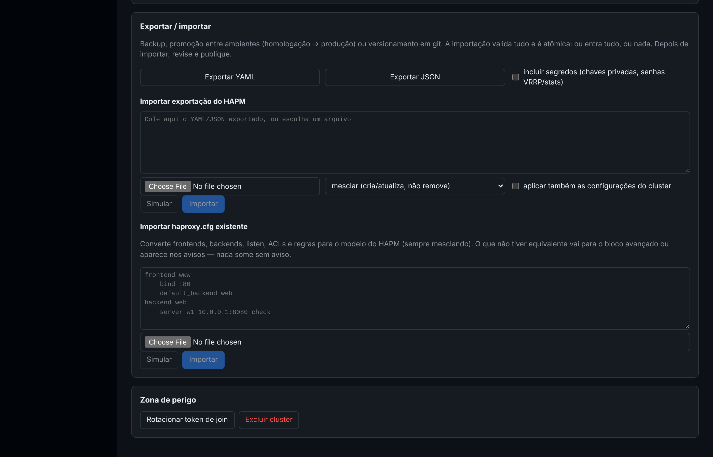

# Operação do dia a dia

Este guia cobre o que se faz depois que o cluster está no ar: acompanhar a linha do tempo, drenar servidores para
manutenção, exportar/importar configuração, migrar um `haproxy.cfg` existente e o ciclo de vida dos nós na AWS.
Alertas: [alertas.md](alertas.md). Logs de acesso: [logs.md](logs.md).

## Linha do tempo

A **Visão geral** de cada cluster mostra os eventos mais recentes (o botão "ver mais" lista até 300):

| Evento | Significado |
|---|---|
| nó registrado / nó removido | agente conectou pela primeira vez / nó removido (scale-in, remoção automática ou manual) |
| MASTER / VRRP | quem assumiu o VIP e cada transição VRRP (BACKUP → MASTER, MASTER → FAULT...) |
| failover | o VIP passou de um nó para outro (com os dois nomes) |
| nó offline / nó online | sem heartbeat pelo tempo configurado / voltou (com quanto tempo ficou fora) |
| split-brain / sem MASTER / VRRP normal | mais de um MASTER, nenhum MASTER, situação normalizada |
| servidor DOWN / servidor UP | health-check do HAProxy (em quais nós) |
| operação | drenar / manutenção / peso feitos na tela (quem, quando, motivo) |
| publicação falhou | versão que falhou e para qual versão os nós voltaram |

Os eventos ficam no banco (os 2000 mais recentes por cluster) e alimentam os [alertas](alertas.md).
API: `GET /api/clusters/{id}/events?limit=50`.

## Drenar, manutenção e peso (sem publicar)

Na aba **Métricas › Servidores**, cada servidor tem os botões:

- **drenar**: não recebe novas conexões, exceto de clientes com sessão persistente (cookie) nele; as em andamento terminam normalmente. Use antes de
  reiniciar/atualizar o servidor;
- **manutenção**: sai do balanceamento imediatamente;
- **pronto**: volta ao estado da configuração;
- **peso**: muda o peso (0–256) — útil para canário (ex.: 10 em um servidor novo) ou para aliviar um servidor.

Como funciona:

1. o manager guarda o **estado desejado** (tabela `server_overrides`) e registra auditoria e linha do tempo;
2. cada agente recebe esse estado no próximo heartbeat (≤ 5 s) e o aplica pela **runtime API** do HAProxy
   (`set server <backend>/<servidor> state drain|maint|ready` e `weight N`), comparando antes com `show servers state`
   — só envia o que difere;
3. depois de **cada publicação** (reload), o agente reaplica na hora: o servidor drenado continua drenado;
4. se um nó falhar ao aplicar (ex.: servidor inexistente), o erro aparece na própria tela.

Servidores marcados como "Desativado" na configuração continuam em manutenção — o agente só mexe neles se você pedir.
API: `GET /api/clusters/{id}/runtime` e `PUT /api/clusters/{id}/runtime/servers/{backend}/{servidor}`
`{"state": "drain|maint|ready", "weight": 50, "reason": "..."}` (OPERATOR).

## Exportar e importar

**Configurações › Exportar / importar** (ADMIN):

- **Exportar YAML/JSON**: configurações do cluster, backends, listeners e certificados. Sem "incluir segredos", a chave
  privada dos certificados e as senhas de VRRP/stats ficam de fora (o arquivo pode ir para o git). Com segredos, trate o
  arquivo como credencial.
- **Importar** em um cluster existente:
  - *mesclar*: cria o que não existe e atualiza o que existe (pelo nome); nada é removido;
  - *substituir*: além disso, remove listeners/backends/certificados que não estão no documento;
  - *aplicar também as configurações do cluster*: atualiza topologia, keepalived, haproxy global etc.
- **Importar cluster** (página inicial): cria um cluster novo a partir de uma exportação (útil para promover
  homologação → produção, trocando só os IPs/VIPs).

**Simular** mostra o que seria criado/atualizado/removido sem gravar. A importação é **atômica** (uma transação: ou
entra tudo, ou nada) e passa pelas mesmas validações do cadastro, inclusive referências entre listeners e backends,
modos http/tcp e conflitos de porta. Certificados exportados sem chave geram aviso (envie o PEM depois); certificados
ACME são reemitidos. Depois de importar, revise e **publique**.

API (ADMIN): `GET /api/clusters/{id}/export?format=yaml&secrets=false`, `POST /api/clusters/import?name=...&dryRun=true`,
`POST /api/clusters/{id}/import?mode=merge|replace&settings=false&dryRun=true` (corpo: o YAML/JSON).

## Importar um haproxy.cfg existente

Na mesma tela, cole ou escolha o arquivo e clique em **Simular**. O conversor entende:

| No haproxy.cfg | Vira no HAProxy Manager |
|---|---|
| `frontend` | listener (binds, `ssl`, `alpn h2`, `maxconn`, `timeout client`, `option forwardfor`) |
| `backend` | backend (servidores com peso/backup/maxconn/disabled/ssl, `balance`, `option httpchk`, `http-check send/expect`, `default-server inter/fall/rise`, `cookie ... insert`, `compression algo gzip`, timeouts) |
| `listen` | um listener + um backend `<nome>-be` |
| `acl` + `use_backend ... if` | regras com condições E/NÃO (host, `hdr_dom`/`hdr_end`, caminho, método, IP de origem, header, SNI); ACLs repetidas viram OU de valores |
| `http-request deny/redirect/set-header/del-header`, `http-response set-header` | regras; `redirect scheme https` vira "Redirecionar HTTP→HTTPS"; HSTS vira a opção HSTS |
| `defaults` (timeouts) e `global` (`maxconn`, `nbthread`, `ssl-min-ver`) | configurações do cluster |

O que não tem equivalente vai para o **bloco avançado** da seção (quando é seguro) ou aparece nos **avisos** —
por exemplo condições com `||`, `userlist`, `errorfile`, opções raras de servidor e os arquivos de certificado
(`crt /etc/...`), que precisam ser enviados na aba Certificados. Nada some sem aviso.
API: `POST /api/clusters/{id}/import-haproxy?dryRun=true` (corpo: o arquivo).

## Scale-in na AWS

Com Auto Scaling (topologia **aws-nlb**), instâncias são criadas e destruídas sozinhas. O Terraform
(`deploy/terraform/aws-nlb`) cria um **lifecycle hook** de término; o fluxo é:

1. o ASG decide encerrar a instância e a coloca em `Terminating:Wait` (o NLB já está drenando as conexões dela);
2. o agente vê `autoscaling/target-lifecycle-state = Terminated` no IMDS (IMDSv2) e envia um último heartbeat com
   `leaving=true`;
3. o manager remove o nó, registra "nó removido" na linha do tempo e notifica (info);
4. o agente para de enviar heartbeats e conclui o hook (`complete-lifecycle-action CONTINUE`), liberando o término
   sem esperar o timeout (`lifecycle_hook_timeout`, padrão 120 s).

No instalador: `install-node.sh --aws-lifecycle --asg-hook <hook>:<asg>` (o user-data do Terraform já passa isso; a
permissão `autoscaling:CompleteLifecycleAction` vai no instance profile).

Para instâncias que somem sem avisar (falha de hardware, encerramento forçado), configure em **Configurações › Nós**
"Remover automaticamente nós offline há mais de N minutos" (mínimo 5). Vale para qualquer topologia; em on-premise,
normalmente deixe vazio.
