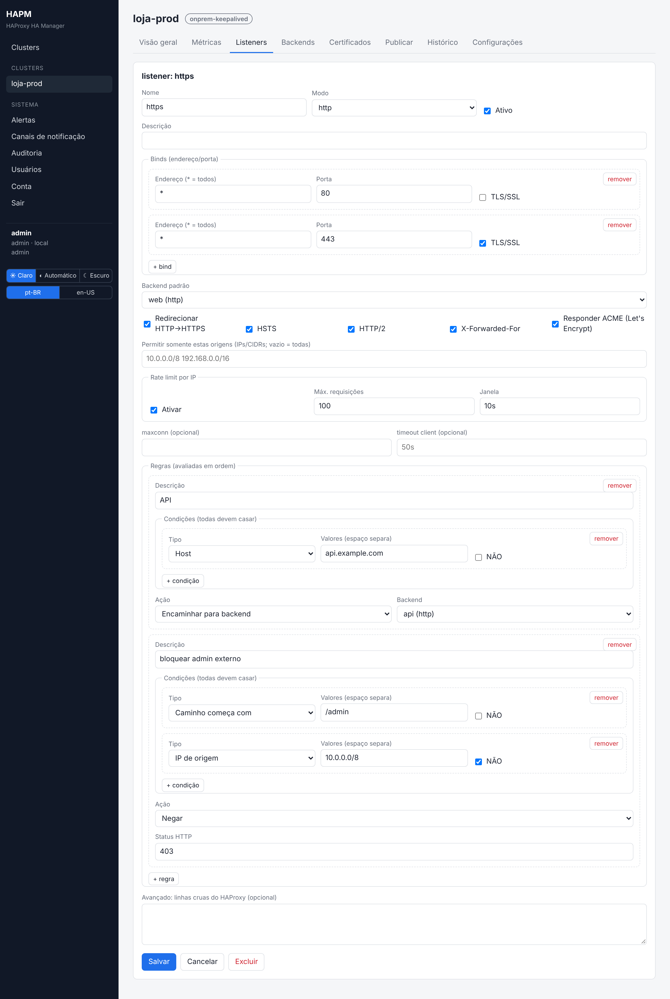
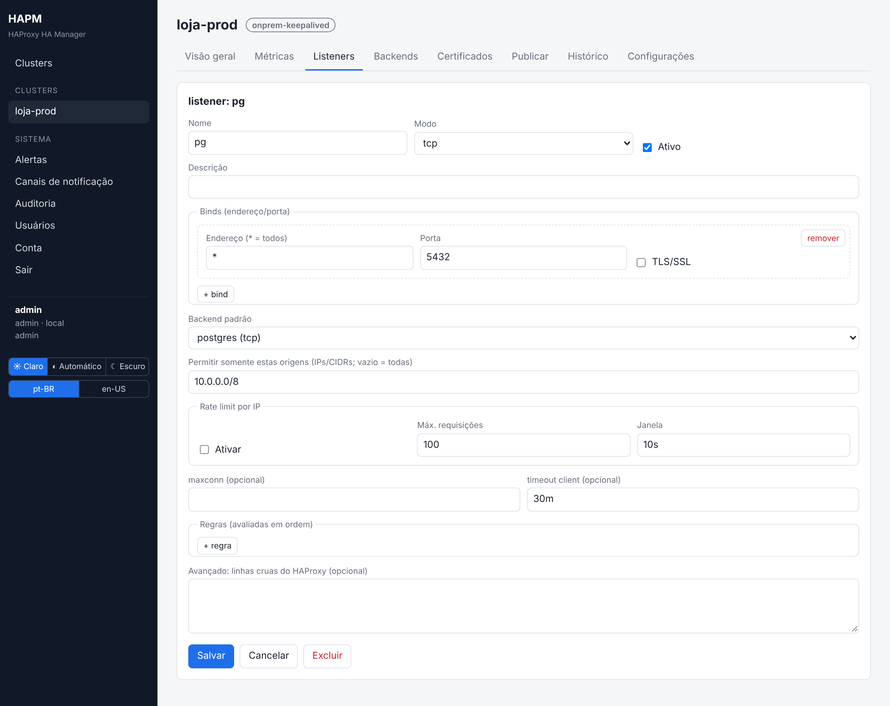
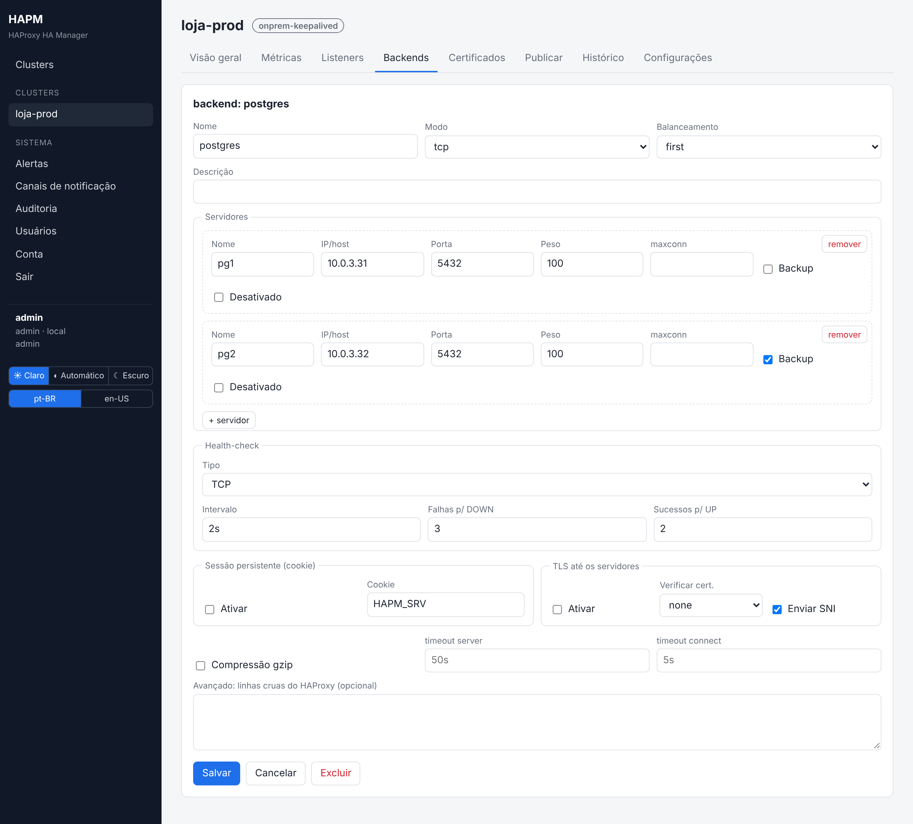
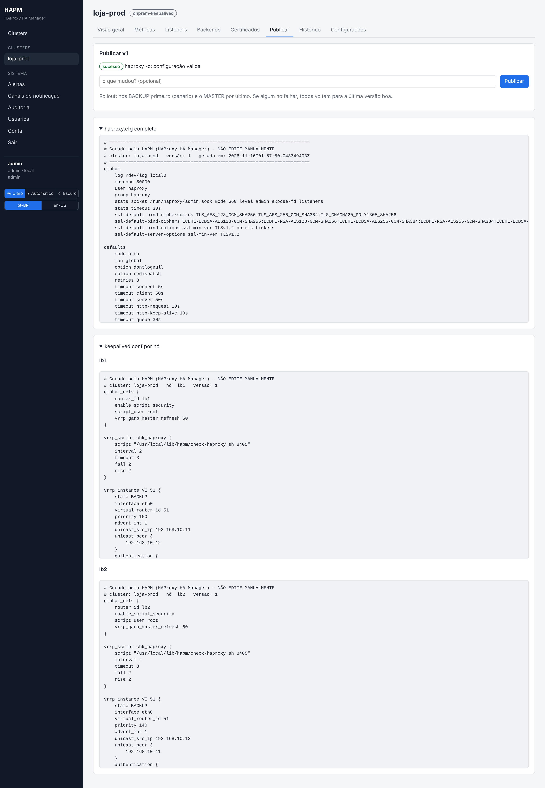

# Primeiros passos: criar e configurar um cluster pela tela

Este guia vai do zero até um par de HAProxy em alta disponibilidade servindo tráfego, tudo pela interface do HAPM.
Pré-requisito: o manager instalado (`deploy/bash/install-manager.sh`, ver [README](../README.md)) e acessível no navegador.

## 1. Entrar

Abra `http://<manager>:8080` e entre com o `admin` inicial (senha definida em `HAPM_ADMIN_PASSWORD` ou impressa no log:
`journalctl -u hapm-manager | grep 'usuário inicial'`) ou pelo LDAP/SSO, se configurado ([autenticacao.md](autenticacao.md)).
Criar e configurar clusters exige o papel **ADMIN**; listeners, backends e certificados exigem **OPERATOR**.

## 2. Criar o cluster

**Clusters › Novo cluster** (painel recolhível no fim da página inicial):

| Campo | O que preencher |
|---|---|
| Nome do cluster | ex.: `loja-prod` |
| Topologia | **On-premise: HAProxy + Keepalived** (VIP via VRRP), **AWS NLB** (o NLB faz a HA; sem keepalived) ou **AWS failover de IP entre ENIs** (keepalived + API da AWS) |
| Rollout | **sequencial** (um nó por vez, MASTER por último; recomendado) ou paralelo |
| Governança de publicação | marque **Exigir aprovação** para que um APPROVER aprove cada publicação (quatro olhos) |
| Keepalived / VRRP | **VIPs** (`192.168.10.100/24`), **Interface** (`eth0`), **Router ID** (único na rede, 1–255), unicast (recomendado), preempção |
| AWS: failover de IP | só na topologia AWS com ENIs. Região; **IP secundário** (nós na mesma subnet) e/ou **IP de overlay + tabelas de rotas** (nós em subnets/AZs diferentes); Elastic IP opcional. Detalhes em [aws-failover.md](aws-failover.md) |
| ACME | e-mail da conta Let's Encrypt e o endereço do manager visto pelo HAProxy (para responder ao HTTP-01) |
| HAProxy global | maxconn, threads, TLS mínimo, timeouts, porta de métricas (8405) etc. Os padrões servem para começar |

Clique em **Criar cluster**. Tudo isso pode ser alterado depois em **Configurações** (aba do cluster).

## 3. Adicionar os nós (instalar o agente)

Abra o cluster. A **Visão geral** mostra, em *Adicionar nós*, o comando pronto com o **token de join** do cluster:

```bash
HAPM_JOIN_TOKEN='...' sudo -E ./install-node.sh --manager-url http://manager:8080 --interface eth0
```

Rode-o em cada servidor HAProxy (a partir do bundle gerado por `deploy/bash/make-bundle.sh`), ou use
`deploy/bash/deploy.sh` para instalar em vários servidores via SSH. O script instala HAProxy, Keepalived e o
`hapm-agent`; o agente se registra sozinho no primeiro heartbeat e o nó aparece na tabela **Nós** em poucos segundos.

Na tabela de nós dá para ajustar a **prioridade VRRP** (vazio = automática, pela ordem de registro) e, na AWS,
a **ENI** de cada nó. O token pode ser rotacionado em Configurações (ADMIN).

## 4. Backends

**Backends › Novo**: nome (`app`), balanceamento, **servidores** (nome, IP, porta, peso, backup), **health-check**
(HTTP `GET /` esperando `200-399`, ou TCP), sessão persistente, TLS até os servidores, compressão.

## 5. Certificados

Aba **Certificados**:
- **Enviar certificado (PEM)**: cole o PEM (certificado + cadeia + chave). O HAPM valida o par chave/certificado e extrai domínios e validade.
- **Emitir com Let's Encrypt (HTTP-01)**: informe os domínios e clique em **Emitir** (o listener na porta 80 precisa ter *Responder ACME* marcado). A renovação é automática 30 dias antes do vencimento
  e, se marcado no cluster, publicada automaticamente.

Certificados perto de vencer geram **alertas** (tela, e-mail, Teams, webhook) — ver [alertas.md](alertas.md).

## 6. Listeners (frontends) e regras

**Listeners › Novo**: nome, modo HTTP/TCP, **binds** (`*:80`, `*:443` com TLS — os certificados são escolhidos por SNI),
backend padrão, redirecionar HTTP→HTTPS, HSTS, HTTP/2, allowlist de IPs, rate limit.
Em **Regras** (avaliadas em ordem): condições (host, caminho, método, IP, header, SNI; todas com AND, com opção NÃO) →
ação (encaminhar para backend, redirecionar, negar, definir/remover header).

Exemplos: listener HTTP com regras (`telas/listener-http.png`) e listener TCP para PostgreSQL (`telas/listener-tcp.png`):





## 7. Publicar

**Publicar** mostra a configuração gerada, o **diff** contra a versão em produção e o resultado do `haproxy -c`.
Clique em **Publicar** (com uma nota). O que acontece:

1. Uma versão imutável é criada.
2. Os nós BACKUP aplicam primeiro (canário); o MASTER por último.
3. Cada agente valida, troca a release de forma atômica, recarrega o HAProxy sem derrubar conexões e confere o health-check;
   se algo falhar, volta sozinho para a release anterior, e a publicação inteira volta à última versão boa.

Com **aprovação obrigatória**, o botão cria um *pedido*; um APPROVER (que não seja quem pediu) aprova em **Aprovações**,
e só então a publicação ocorre. ADMIN pode fazer publicação emergencial (auditada).



**Histórico** guarda todas as versões, com diff e **rollback** em um clique.

## 8. Acompanhar

- **Visão geral**: nós online, quem é MASTER (e alerta de split-brain), VIPs, versão publicada, alertas pendentes do cluster.
- **Métricas**: req/s, respostas 2xx–5xx, sessões, tráfego e estado de backends/servidores ao vivo (última 1 h),
  por cluster ou por nó. Para histórico longo e alertas de tráfego: Prometheus + Grafana ([README › Observabilidade](../README.md#observabilidade)).
- **Alertas** (barra lateral): certificados vencendo, falhas ACME.
- **Auditoria**: quem fez o quê e quando.

## Failover é automático

Depois de publicado, o failover **não depende do manager nem de ninguém**: ele acontece nos próprios nós.

- O Keepalived roda VRRP entre os nós e executa a cada `checkInterval` o `check-haproxy.sh`, que consulta o `/healthz`
  do HAProxy local. Se o HAProxy parar ou o servidor cair, o nó perde o papel de MASTER e o próximo de maior
  prioridade assume o VIP (gratuitous ARP). Nos testes: **~3 s** no lab Docker e **~6 s** em VMs com systemd
  (parando o HAProxy do MASTER).
- **AWS (failover de IP entre ENIs)**: ao virar MASTER, o keepalived chama `keepalived-notify.sh`, que usa a API da AWS
  (credenciais do instance profile) para mover o IP secundário, atualizar as rotas do IP de overlay e reassociar o
  Elastic IP para a ENI do novo MASTER, com até 5 tentativas. O agente roda um *preflight* (permissões IAM com
  `--dry-run`, subnet, tabelas de rotas) a cada 5 minutos e mostra o resultado na Visão geral, para você descobrir um
  problema de permissão antes do dia do failover.
- **AWS NLB**: o NLB tira do ar o nó cujo health-check falhar.
- Com **preempção** ligada, o nó de maior prioridade retoma o VIP quando volta; desligue-a para evitar uma segunda troca.

O manager pode ficar fora do ar sem afetar o tráfego nem o failover: ele só é necessário para alterar e publicar configuração.
